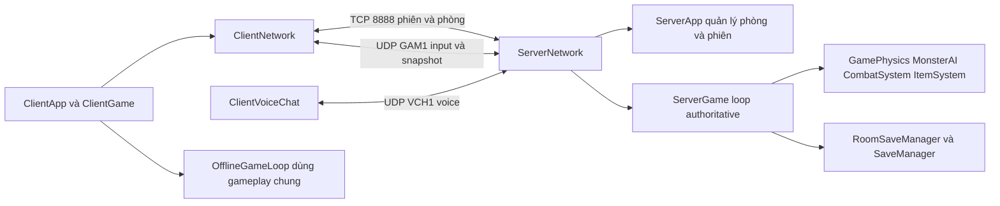
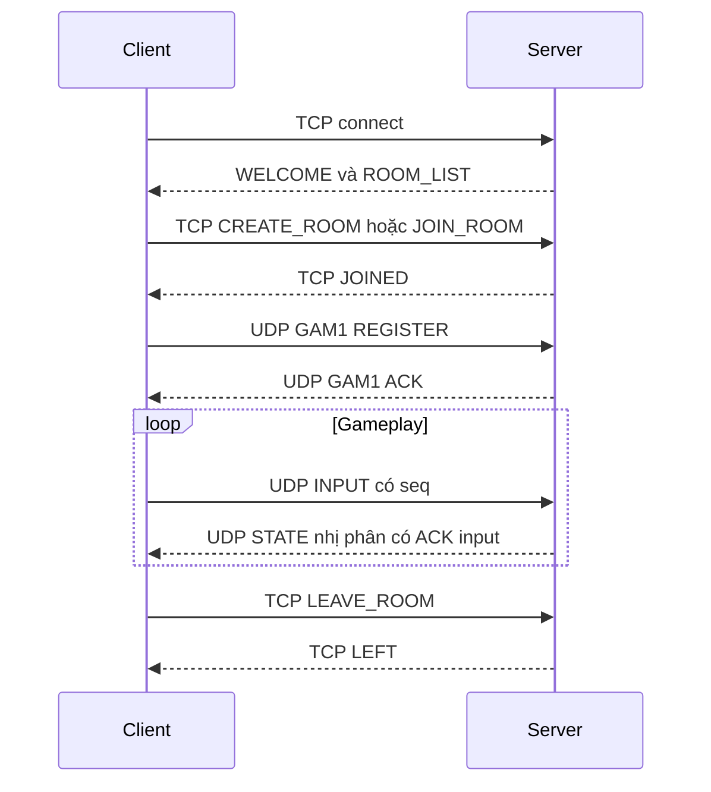

# Game 2D Co-op – Bài tập lớn Lập trình mạng

Nhóm 6 xây dựng game 2D nhìn từ trên xuống bằng Java thuần. Online dùng dedicated server authoritative: client gửi ý định điều khiển, server quyết định vị trí, sát thương, quái và vật phẩm. Offline tái sử dụng gameplay chung, không cần server. Cập nhật tài liệu ngày **19/11/2026**, đối chiếu code `7fd270b`.

## Thành viên

| Họ và tên | MSSV | Email |
|---|---|---|
| Trần Văn Đức | B23DCCN191 | b23dccn191@ptit.edu.vn |
| Nguyễn Minh Hiền | B23DCCN289 | b23dccn289@ptit.edu.vn |
| Vũ Hải Dương | B23DCCN233 | b23dccn233@ptit.edu.vn |

Đóng góp cần đối chiếu lịch sử commit và phần việc thực tế. Commit `e80cd5c` tích hợp gameplay vào kiến trúc refactor; merge `7fd270b` nối lịch sử nhánh Đức sau tích hợp thủ công.

## Chức năng hiện có

- Menu, lobby, tạo/vào/rời phòng, tối đa bốn người mỗi phòng.
- Di chuyển/va chạm; prediction và reconciliation local, nội suy người chơi khác.
- Slime dùng A* để đuổi/đánh; chiến đấu kiểm vật cản, sát thương và hồi sinh.
- Bình máu trên map và do quái rơi, tự nhặt khi thiếu HP, có giới hạn số lượng và TTL của drop.
- Gameplay UDP với sequence, snapshot nhị phân full/delta, ghép mảnh và stream phòng.
- Token phiên và grace 20 giây sau khi phát hiện TCP disconnect để thử RESUME.
- Voice PCM qua UDP relay theo phòng; M mute/unmute.
- Save JSON offline và slot player online; chưa lưu toàn bộ thế giới/campaign.

## Kiến trúc và công nghệ

| Thành phần | Cài đặt |
|---|---|
| Ngôn ngữ | JDK 17+, thư viện chuẩn, không cần Maven/Gradle |
| Giao diện | Swing/AWT, cập nhật UI qua EDT |
| TCP 8888 | Phiên, lobby, tạo/vào/rời phòng và RESUME |
| UDP 8888 | Gameplay GAM1 và voice VCH1, chung socket server |
| Mô phỏng | Mỗi phòng một ServerGame, mục tiêu 60 tick/s |
| Map | TMX/TSX, CSV tile layer, 3×3 chunk, mỗi chunk 32×32 tile |
| Tài nguyên | source/content, map đang dùng là source/content/map |



Đây là sơ đồ hiện tại. Hai PNG `statics/diagram.png`, `statics/network_flow.png` là sơ đồ trước refactor; không dùng chúng làm đặc tả hiện hành.

## Build và chạy

Cần **JDK 17+**, có cả `java` và `javac` trên PATH. Chạy từ thư mục gốc trong CMD/Git Bash:

```bat
run-server.bat
run-client.bat
```

PowerShell dùng `.\run-server.bat` và `.\run-client.bat`. Online: chạy server trước, mở từng client, chọn Chơi online, nhập IP server, kết nối rồi tạo/vào phòng. Cùng máy dùng `localhost`/`127.0.0.1`; khác máy cùng LAN dùng IP LAN server và cho phép **TCP lẫn UDP 8888** qua firewall. Offline chỉ cần client rồi chọn Chơi offline.

Game không bắt buộc ZeroTier. LAN ảo là một cách tạo tuyến khi các máy khác mạng chưa truy cập trực tiếp được server. Chưa có lời mời bạn bè, matchmaking hoặc NAT traversal. Nên dùng cùng bản build cho mọi client và server; chưa có handshake phiên bản toàn phiên.

Chỉ biên dịch:

```bat
run-server.bat --compile-only
run-client.bat --compile-only
```

Mỗi launcher có output `.runtime/server-...` hoặc `.runtime/client-...`, TEMP/TMP trong `.runtime/tmp`. Không xóa/ghi đè class của JVM khác, không ghi `.class` vào source. Loại RegressionChecks khỏi build sản xuất. Chỉ dọn `.runtime` sau khi tắt các tiến trình sử dụng nó.

## Điều khiển

| Phím | Hành động |
|---|---|
| WASD/mũi tên | Di chuyển |
| J/chuột trái | Đánh |
| TAB giữ | Bảng người chơi |
| M | Mute/unmute micro online |
| ESC | Xác nhận rời game về menu |

## Giao thức TCP

UTF-8, mỗi message kết thúc bằng LF. GameProtocol.readLineLimited giới hạn client gửi 512 ký tự Java/dòng, server gửi 2048. sanitizeName/sanitizeRoom lọc dấu phân cách; tên tối đa 16 và phòng 20 ký tự Java. Giới hạn ký tự không đồng nghĩa byte UTF-8.

| Chiều | Thông điệp |
|---|---|
| Client → server | `ROOM_LIST` |
| Client → server | `CREATE_ROOM:<phòng>:<tên>` |
| Client → server | `JOIN_ROOM:<phòng>:<tên>` |
| Client → server | `LEAVE_ROOM` |
| Client → server | `RESUME:<token>` |
| Server → client | `WELCOME:<id>:<token>` |
| Server → client | `ROOM_LIST;<phòng> (n/4);...` |
| Server → client | `JOINED:<phòng>`, `RESUMED:<phòng>`, `LEFT` |
| Server → client | `ERROR:<nội dung>`, `RESUME_FAIL` |

INPUT, STATE và heartbeat gameplay hiện **không truyền bằng dòng TCP**. Common còn một số hằng và hàm snapshot văn bản không có nghĩa server đang dùng transport cũ.

## Giao thức UDP gameplay

Header gồm bốn byte ASCII `GAM1`, một byte opcode, rồi payload. REGISTER/ACK/INPUT/PING/PONG dùng UTF-8; STATE là nhị phân.

| Opcode | Tên | Payload |
|---|---|---|
| 1 | REGISTER | token, generation phân cách bằng dấu gạch đứng |
| 2 | ACK | playerId, streamId, generation phân cách bằng dấu gạch đứng |
| 3 | INPUT | `seq:left:right:up:down:attack:pingMs` |
| 4 | STATE | Snapshot nhị phân phiên bản 2 |
| 5 và 6 | PING/PONG | Echo thời gian để client tính RTT/jitter |

Sau JOINED/RESUMED, client đăng ký endpoint UDP bằng token. ACK xác nhận generation và stream. Server buffer input mới nhất theo sequence rồi mô phỏng theo tick, không biến mỗi datagram thành một bước di chuyển độc lập.

STATE có streamId, sequence, baselineSequence, partIndex/totalParts; tối đa **499 byte/datagram ứng dụng**: 5 byte header chung + 29 byte header mảnh + tối đa 465 byte body. Chưa cộng header UDP/IP. Full phát ban đầu, khi yêu cầu và mỗi 60 state sequence; delta dựa trên full baseline. Decoder chỉ xuất trạng thái khi đủ mảnh và đúng baseline/stream.



## Voice UDP

Magic VCH1 và một byte loại: REGISTER=1, AUDIO=2, ACK=3. PCM signed 16 kHz, 16 bit, mono, little-endian; frame mục tiêu 640 byte/20 ms. Client có socket voice riêng, server relay tới thành viên khác cùng phòng. Chưa có codec nén, jitter buffer thích nghi hoặc mixer đa stream. Thiếu thiết bị được báo riêng, không ngăn gameplay.

## Save và vòng đời phòng

- `saves/offline_save.json`: thông tin nhân vật offline.
- `saves/online_<tênPhòng>.json`: tối đa bốn slot tên/vị trí/HP/trạng thái; server ghi.
- Chưa lưu quái, drop, campaign/checkpoint hoặc token. Tạo lại cùng tên có thể nạp slot cũ nhưng dựng lại quái/item.
- Phòng hết người bị xóa ở RAM; save vẫn còn. Lobby không phải danh mục chiến dịch đã lưu.
- Slot nhận lại theo tên không phân biệt hoa thường; bốn tên lịch sử có thể chiếm hết slot dù lobby 1/4. Thông báo phân biệt đầy online và đầy save.
- RESUME dùng token trong RAM và grace 20 giây sau khi phát hiện đứt TCP, không phải đăng nhập lại hôm sau.

## Cấu trúc source

| Module | Class sản xuất |
|---|---|
| source/client | ClientApp, ClientGame, ClientNetwork, ClientMovement, ClientRenderer, ClientVoiceChat, OfflineGameLoop, ScoreboardOverlay |
| source/common | Common, GameData, GameProtocol, GameMap, GamePhysics, MonsterAI, CombatSystem, SpawnSystem, ItemSystem, SaveManager |
| source/server | ServerApp, ServerNetwork, ServerSession, ServerGame, RoomSaveManager |

Có 23 file Java sản xuất và sáu RegressionChecks. Xem README từng module. Content có 143 tài nguyên: 119 PNG, bốn WAV, 20 TMX/TSX. Asset được nhập không đồng nghĩa mọi tính năng tương ứng đã có.

## Kiểm thử và giới hạn

Sáu chương trình: PortedGameplayRegressionChecks, AuditRegressionChecks, LobbySpawnRegressionChecks, RoomAdmissionRegressionChecks, AssetRegressionChecks, LauncherRegressionChecks.

Lần kiểm chứng **18/11/2026**: bốn bộ gameplay/audit/lobby/admission đạt tổng 396 điều kiện; asset giải mã đủ 143 tài nguyên, đối chiếu 2304 pixel bình máu; launcher nạp class muộn và cách ly output đạt. Đây không phải benchmark Internet, voice nhiều thiết bị hay tải nhiều phòng.

Giới hạn: danh tính save còn gắn tên; INPUT chưa có stream/generation để chặn gói trễ sau đổi phòng; thiếu timeout nhả input khi UDP im lặng; prediction chưa khớp chặt input–tick; save JSON thủ công/chưa nguyên tử; queue worker chưa bounded; thiếu handshake phiên bản toàn phiên và bảo vệ mã hóa/xác thực mạnh.

## Tài liệu và dataset

- `docs/BÁO CÁO TIẾN ĐỘ DỰ ÁN GAME 2D CO-OP.docx`: báo cáo tiến độ cập nhật.
- `docs/Giai_thich_du_an_va_van_dap_Game2DCoop.docx`: tài liệu học/vấn đáp ngày 18/11/2026; ghi chú README cũ mô tả thời điểm trước lần cập nhật README này.
- `statics/dataset_sample.csv`: **dữ liệu minh họa lịch sử**, không được code hiện tại đọc hoặc sinh ra; không cần để chạy game. Xem `statics/README.md`.
- CSV bên trong TMX là dữ liệu tile GameMap thực sự đọc, khác dataset mẫu.
- statics/dev.txt, sơ đồ PNG và ảnh demo cũ là tư liệu lịch sử, không là đặc tả/benchmark hiện tại.
- .gitignore loại saves, logs, .runtime và .class. INSTRUCTION.md là quy định bài tập, giữ nguyên.

## Kế hoạch

1. Handshake phiên bản, room epoch cho input và timeout khi thiếu dữ liệu.
2. Danh tính bền/campaign/phòng tách biệt, chọn tiếp tục và mã mời.
3. Parser JSON chuẩn, schemaVersion, backup và ghi nguyên tử.
4. Đo loss/jitter/RTT/correction/tick trong kịch bản tái hiện; demo hai máy và voice thật.
5. Hướng dẫn triển khai server mạng ngoài, đóng gói bản thử nghiệm.
