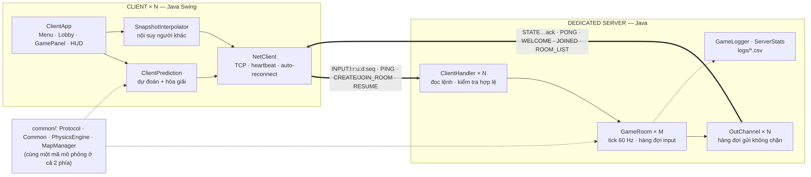
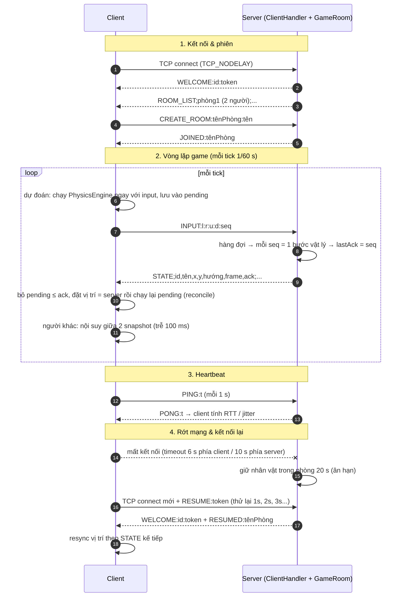
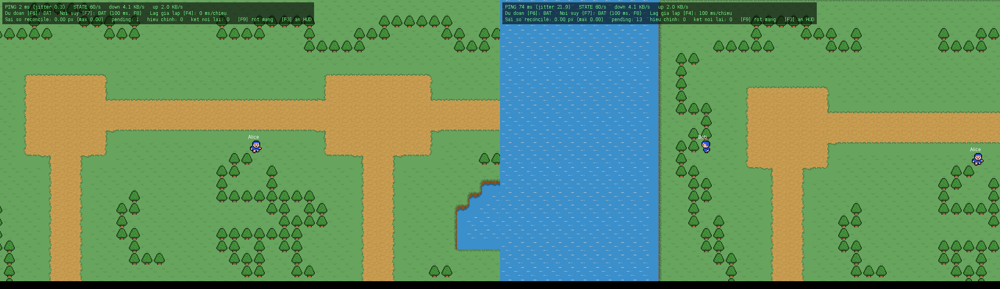
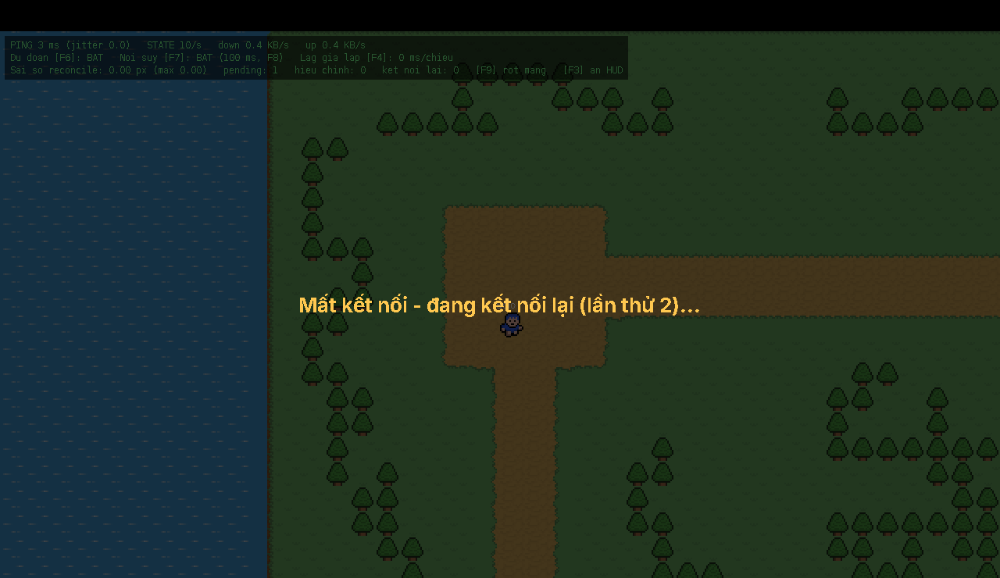

# BÀI TẬP LỚN: LẬP TRÌNH MẠNG

## 🎮 Game 2D Co-op – Dungeon Crawler

---

## 🧑‍💻 THÔNG TIN NHÓM

| STT | Họ và Tên | MSSV | Email | Đóng góp |
|-----|-----------|------|-------|----------|
| 1 | Trần Văn Đức | B23DCCN191 | b23dccn191@ptit.edu.vn | *(xem commit history)* |
| 2 | Nguyễn Minh Hiền | B23DCCN289 | b23dccn289@ptit.edu.vn | *(xem commit history)* |
| 3 | Vũ Hải Dương | B23DCCN233 | b23dccn233@ptit.edu.vn | *(xem commit history)* |

**Tên nhóm:** Nhóm 6 – Lập trình mạng  
**Chủ đề đã đăng ký:** Game 2D Co-op

---

## 🧠 MÔ TẢ HỆ THỐNG

Hệ thống là một **game 2D top-down co-op nhiều người chơi** xây dựng hoàn toàn bằng Java thuần.

- **Server** (Dedicated Server): Tiếp nhận kết nối TCP từ nhiều client, quản lý các phòng chơi (Game Room), chạy vòng lặp vật lý game ở tốc độ 60 FPS và broadcast trạng thái game cho toàn bộ người chơi trong phòng.
- **Client**: Giao diện đồ họa Java Swing, cho phép người chơi tạo/vào phòng, di chuyển nhân vật bằng phím WASD hoặc mũi tên. Client hỗ trợ cả chế độ **Offline Test** (không cần server) lẫn **Online** (kết nối server qua TCP).
- **Common**: Module dùng chung giữa server và client — hằng số giao thức, quản lý bản đồ (Tiled TMX chunks), vật lý va chạm.

**Cấu trúc logic tổng quát:**
```
[ClientApp A] ──┐
[ClientApp B] ──┼──TCP:8888──► [ServerApp]
[ClientApp C] ──┘                   │
                               [GameRoom]
                               (quản lý phòng, physics 60FPS)
                                    │
                              [MapManager]
                              (9 chunks TMX 3×3)
```

**Sơ đồ hệ thống:**



---

## ⚙️ CÔNG NGHỆ SỬ DỤNG

| Thành phần | Công nghệ | Ghi chú |
|------------|-----------|---------|
| Ngôn ngữ | Java 17+ | Không cần framework ngoài |
| Giao thức mạng | TCP Socket (java.net) | Plain-text, line-delimited |
| Giao diện | Java Swing (JFrame, JPanel) | Render tile map + player |
| Bản đồ | Tiled TMX (CSV encoding) | 9 chunk 32×32 tiles |
| Build | `javac` + `.bat` script | Không cần Maven/Gradle |
| Port | `8888` | Có thể đổi trong `Common.java` |

---

## 🚀 HƯỚNG DẪN CHẠY DỰ ÁN

### Yêu cầu
- **Java JDK 17+** đã được cài và thêm vào PATH

### 1. Clone repository
```bash
git clone https://github.com/duongakrapovic/Game2DCo-op.git
cd Game2DCo-op
```

### 2. Chạy Server (nếu chơi Online)
Double-click file `run-server.bat` hoặc chạy lệnh:
```bash
run-server.bat
```
Server sẽ tự động compile và lắng nghe tại **port 8888**.

### 3. Chạy Client
Double-click file `run-client.bat` hoặc chạy lệnh:
```bash
run-client.bat
```
Khi khởi động, client hiển thị hộp thoại chọn chế độ:
- **"Test Offline (Không cần Server)"** — Chơi đơn, không cần chạy server
- **"Online (Kết nối Server)"** — Nhập IP server → Nhập tên người chơi → Vào sảnh chờ

### 4. Điều khiển
| Phím | Hành động |
|------|-----------|
| `W` / `↑` | Di chuyển lên |
| `S` / `↓` | Di chuyển xuống |
| `A` / `←` | Di chuyển trái |
| `D` / `→` | Di chuyển phải |
| `ESC` | Thoát về menu |
| `F3` | Bật/tắt HUD mạng (ping, jitter, băng thông, sai số) |
| `F4` | Đổi độ trễ giả lập mỗi chiều: 0 → 50 → 100 → 200 → 400 ms |
| `F6` / `F7` | Bật/tắt dự đoán (prediction) / nội suy (interpolation) — để so sánh khi demo |
| `F8` | Đổi độ trễ nội suy: 50 / 100 / 150 / 250 ms |
| `F9` | Giả lập rớt mạng (client tự kết nối lại) |

### 5. Chơi Online (nhiều người)
1. Một người chạy `run-server.bat`
2. Tất cả người chơi chạy `run-client.bat` → chọn **Online** → nhập IP của người chạy server
3. Một người chọn **"Tạo phòng"** → những người khác chọn phòng và nhấn **"Vào phòng"**

> **Lưu ý:** Để chơi qua Internet mà không có IP public, dùng **ZeroTier** hoặc **Hamachi** để tạo mạng LAN ảo.

---

## 🔗 GIAO TIẾP (GIAO THỨC SỬ DỤNG)

Giao thức TCP dạng văn bản (UTF-8), **mỗi message là một dòng** (`\n`). Lệnh phân cách bằng `:`, trạng thái dùng `;` và `,`.
Để không phá định dạng, **tên người chơi không được chứa `; , : |`** và **tên phòng không có khoảng trắng** — server
tự lọc các ký tự này (xem `Protocol.sanitizeName / sanitizeRoom`). Client → Server tối đa 512 ký tự/dòng.



### Client → Server

| Lệnh | Định dạng | Mô tả |
|------|-----------|-------|
| Danh sách phòng | `ROOM_LIST` | Yêu cầu danh sách phòng |
| Tạo phòng | `CREATE_ROOM:<phòng>:<tên>` | Tạo phòng và vào ngay. Trả `JOINED` hoặc `ERROR` |
| Vào phòng | `JOIN_ROOM:<phòng>:<tên>` | Vào phòng có sẵn (tối đa `MAX_PLAYERS_PER_ROOM` = 4). Tự rời phòng cũ nếu đang ở phòng khác |
| Rời phòng | `LEAVE_ROOM` | Rời phòng, về sảnh |
| Gửi đầu vào | `INPUT:<left>:<right>:<up>:<down>[:<seq>]` | Trạng thái phím (`true`/`false`), gửi **mỗi tick 60 Hz** kèm `seq` tăng dần. `seq` không bắt buộc (client cũ) |
| Heartbeat | `PING:<t>` | Mỗi 1 giây; server trả nguyên `t` trong `PONG` |
| Kết nối lại | `RESUME:<token>` | Gửi trên kết nối mới sau khi rớt mạng để lấy lại chỗ trong phòng |

### Server → Client

| Lệnh | Định dạng | Mô tả |
|------|-----------|-------|
| Chào | `WELCOME:<id>:<token>` | Ngay khi kết nối: id người chơi + token phiên (dùng cho `RESUME`) |
| Danh sách phòng | `ROOM_LIST;<phòng1> (N người);...` | Khi kết nối, khi được hỏi, và **tự đẩy** cho người ở sảnh mỗi khi phòng thay đổi |
| Đã vào phòng | `JOINED:<phòng>` | Client chỉ chuyển sang màn hình game khi nhận được lệnh này |
| Đã rời phòng | `LEFT` | Phản hồi `LEAVE_ROOM` |
| Trạng thái game | `STATE;<id>,<tên>,<x>,<y>,<hướng>,<frame>,<ack>;...` | 60 lần/giây. `x,y` có 2 chữ số thập phân; `ack` = `seq` cuối cùng server đã xử lý cho người đó (`-1` nếu chưa có) |
| Trả lời ping | `PONG:<t>` | Echo của `PING` |
| Kết nối lại | `RESUMED:<phòng>` / `RESUME_FAIL` | Kết quả của `RESUME` |
| Lỗi | `ERROR:<thôngBáo>` | Sai cú pháp, phòng đầy / đã tồn tại / không tồn tại... |

**Ví dụ luồng:**
```
Server → Client : WELCOME:P1:9f3a1c5e7b2d4a60
Server → Client : ROOM_LIST
Client → Server : CREATE_ROOM:DungeonA:Duc
Server → Client : JOINED:DungeonA
Client → Server : INPUT:false:true:false:false:0        (tick 0: đi phải)
Server → Client : STATE;P1,Duc,712.0,576.0,right,2,0    (đã xử lý seq 0)
Client → Server : PING:81234567890
Server → Client : PONG:81234567890
```

---

## 🌐 CƠ CHẾ MẠNG (ĐIỂM NỔI BẬT)

| # | Cơ chế | Giải quyết vấn đề gì | Cài đặt |
|---|--------|----------------------|---------|
| 1 | **Tick cố định 60 Hz + hàng đợi input có `seq`** | Server chạy đúng 60 tick/s (bộ tích lũy thời gian, không trôi). Mỗi `seq` = đúng 1 bước vật lý ⇒ kết quả tất định | `GameRoom` |
| 2 | **Client-side prediction + server reconciliation** | Nhân vật của mình phản hồi tức thì thay vì chờ RTT. Khi có `STATE`: bỏ input đã `ack`, lấy vị trí server làm gốc rồi chạy lại input chưa `ack` | `ClientPrediction` |
| 3 | **Entity interpolation** | Người chơi khác di chuyển mượt dù gói đến không đều: vẽ "chậm 100 ms" và nội suy giữa 2 snapshot | `SnapshotInterpolator` |
| 4 | **Heartbeat + timeout** | `PING/PONG` mỗi giây đo RTT & jitter; không nhận gì 6 s (client) / 10 s (server) ⇒ coi là rớt mạng | `NetClient`, `ClientHandler` |
| 5 | **Tự kết nối lại (session resume)** | Rớt mạng không mất nhân vật: server giữ chỗ 20 s, client thử lại 1 s, 2 s, 3 s... và gửi `RESUME:<token>` | `NetClient`, `ServerApp`, `Session` |
| 6 | **Gửi không chặn + gộp snapshot (back-pressure)** | Một client mạng chậm không được làm đứng cả phòng. Game loop chỉ bỏ vào hàng đợi; `STATE` cũ chưa gửi bị thay bằng bản mới | `OutChannel` |
| 7 | **Kiểm tra dữ liệu & chống lạm dụng** | Lệnh sai/thiếu tham số → `ERROR` (không còn làm chết luồng); giới hạn độ dài dòng; tối đa 300 message/giây/client; lọc ký tự cấm; `TCP_NODELAY` | `ClientHandler`, `Protocol` |
| 8 | **Quản lý phòng an toàn** | Mỗi client chỉ ở 1 phòng; giới hạn 4 người; phòng trống bị xóa **và dừng luồng game loop**; đẩy `ROOM_LIST` khi có thay đổi | `ServerApp` |
| 9 | **Log & thống kê** | `logs/game_state_*.csv` (10 Hz, cột như `statics/dataset_sample.csv`), `logs/net_stats.csv` (client, msg/s, KB/s mỗi 5 s) | `GameLogger`, `ServerStats` |
| 10 | **Giả lập mạng xấu để demo** | Thêm độ trễ giả lập mỗi chiều, bật/tắt prediction và interpolation, giả lập rớt mạng ngay trong game | `NetClient`, phím F3–F9 |


---

## 📊 KẾT QUẢ THỰC NGHIỆM

### Giao diện (2 client trong 1 phòng; cửa sổ phải đang giả lập lag 100 ms mỗi chiều)



HUD (phím `F3`) hiển thị ping, jitter, số `STATE`/giây, băng thông và sai số reconcile. Khi mất kết nối:



### Đo tải bằng bot (`run-bench.bat`)

Mỗi bot gửi `INPUT` 60 lần/giây như client thật, 4 bot/phòng, chạy 10 giây. Server và bot chạy **cùng một máy** (localhost)
nên RTT chỉ phản ánh chi phí xử lý của server, không phải độ trễ Internet.

| Số bot | Số phòng | Rớt kết nối | RTT trung bình | RTT p95 | RTT lớn nhất | `STATE`/giây/bot | Tải xuống/bot | Tải lên/bot |
|-------:|---------:|------------:|---------------:|--------:|-------------:|-----------------:|--------------:|------------:|
| 4  | 1  | 0 | 0.71 ms | 3.32 ms | 6.33 ms  | 60.1 | 7.9 KB/s | 2.0 KB/s |
| 16 | 4  | 0 | 0.47 ms | 1.35 ms | 9.54 ms  | 60.1 | 8.3 KB/s | 2.0 KB/s |
| 40 | 10 | 0 | 0.32 ms | 1.03 ms | 5.52 ms  | 60.1 | 8.8 KB/s | 2.0 KB/s |
| 80 | 20 | 0 | 0.24 ms | 0.59 ms | 11.81 ms | 60.1 | 9.5 KB/s | 2.0 KB/s |

Nhận xét: tần suất cập nhật giữ đúng 60 Hz khi tăng từ 4 lên 80 client; tải xuống mỗi client chủ yếu phụ thuộc số người
**trong cùng phòng** (mỗi `STATE` liệt kê mọi người trong phòng) chứ không phụ thuộc tổng số client. Kết quả thô nằm ở `logs/bench_results.csv`.

### Kiểm thử tự động (`run-selftest.bat`) — 23 kiểm tra

Bắt tay + heartbeat, lệnh sai/dòng quá dài không làm sập kết nối, lọc ký tự cấm, giới hạn 4 người/phòng, tự rời phòng cũ,
`RESUME` sai token, vị trí server khớp mô phỏng cục bộ (có va chạm tường), sai số prediction < 0.5 px khi lag 100 ms,
và tự kết nối lại sau khi rớt mạng (giữ nguyên id và vị trí).

### Cách tự lặp lại thí nghiệm
```bash
run-server.bat                      # cửa sổ 1
run-bench.bat localhost 40 10       # cửa sổ 2: 40 bot, 10 giây
run-selftest.bat                    # cửa sổ 2: kiểm thử tự động
# Demo lag: java -cp . source.client.ClientApp --lag=150  (hoặc bấm F4 trong game)
```

---

## 🧩 CẤU TRÚC DỰ ÁN
```
Game2DCo-op/
├── README.md                    ← Tài liệu dự án
├── INSTRUCTION.md               ← Hướng dẫn GV (không chỉnh sửa)
├── run-server.bat               ← Compile + chạy server
├── run-client.bat               ← Compile + chạy client
├── run-bench.bat                ← Đo tải bằng bot
├── run-selftest.bat             ← Kiểm thử tự động phần mạng
├── statics/
│   ├── diagram.png              ← Sơ đồ hệ thống
│   ├── network_flow.png         ← Sơ đồ luồng giao tiếp
│   ├── demo_*.png               ← Ảnh chạy thử
│   ├── logo.png
│   └── dataset_sample.csv       ← Mẫu log game state (định dạng giống logs/game_state_*.csv)
└── source/
    ├── common/                  ← Dùng chung server & client
    │   ├── Common.java          ← Hằng số: PORT, TICK_RATE, tên lệnh giao thức...
    │   ├── Protocol.java        ← Giới hạn, timeout, lọc tên, đọc dòng có giới hạn
    │   ├── Player.java · AnimationController.java
    │   ├── PhysicsEngine.java   ← Vật lý top-down tất định (server & client dự đoán dùng chung)
    │   └── MapManager.java      ← Nạp bản đồ TMX, va chạm tile
    ├── server/
    │   ├── ServerApp.java       ← Entry point, quản lý phòng + phiên (ân hạn / resume)
    │   ├── ClientHandler.java   ← Đọc & kiểm tra lệnh của 1 client
    │   ├── Session.java         ← Phiên người chơi (độc lập với socket)
    │   ├── GameRoom.java        ← Phòng: tick 60 Hz, hàng đợi input, STATE
    │   ├── OutChannel.java      ← Kênh gửi không chặn, gộp snapshot
    │   ├── GameLogger.java      ← Log CSV trạng thái game
    │   └── ServerStats.java     ← Thống kê lưu lượng
    ├── client/
    │   ├── ClientApp.java       ← UI Swing, lobby, vẽ, HUD
    │   ├── NetClient.java       ← TCP, heartbeat, tự kết nối lại, giả lập lag
    │   ├── ClientPrediction.java← Dự đoán + hòa giải
    │   └── SnapshotInterpolator.java ← Nội suy người chơi khác
    ├── tools/
    │   ├── BotBench.java        ← Đo tải bằng bot
    │   └── NetSelfTest.java     ← Kiểm thử tự động phần mạng
    └── content/
        ├── map/                 ← 9 chunk TMX (3×3) + tileset
        └── player/              ← Sprite nhân vật
```

---

## 🧩 HƯỚNG PHÁT TRIỂN THÊM

- [ ] Thêm lệnh `CHAT` để người chơi nhắn tin trong phòng
- [x] Giới hạn số người tối đa mỗi phòng (`MAX_PLAYERS_PER_ROOM`)
- [ ] Thêm trạng thái `GAME_START` / `GAME_OVER`
- [ ] Thêm mob/enemy do server điều khiển
- [ ] Hỗ trợ kết nối qua Internet với ZeroTier (giao thức là TCP thuần nên về lý thuyết chạy được; nhóm chưa kiểm thử thực tế)
- [x] Tự kết nối lại khi rớt mạng (giữ chỗ 20 s)
- [ ] (Tùy chọn) Chuyển phần `STATE` sang UDP để tránh head-of-line blocking
- [x] Lưu log game state ra file CSV (`logs/`)

---

## 📝 GHI CHÚ

- Repo tuân thủ đúng cấu trúc đã hướng dẫn trong `INSTRUCTION.md`.
- File `INSTRUCTION.md` **không được chỉnh sửa** theo quy định.
- Toàn bộ logic vật lý (va chạm tile) chạy **phía server** — client chỉ render.

---

## 📚 TÀI LIỆU THAM KHẢO

- [Java TCP Socket – Oracle Docs](https://docs.oracle.com/javase/tutorial/networking/sockets/)
- [Tiled Map Editor](https://www.mapeditor.org/) – Công cụ thiết kế bản đồ TMX
- [Java Swing Tutorial](https://docs.oracle.com/javase/tutorial/uiswing/)
- [ZeroTier – LAN ảo qua Internet](https://www.zerotier.com/)
